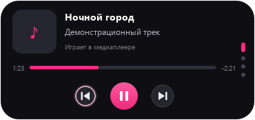
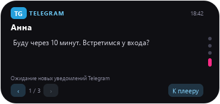

<div align="center">

# Desktop Island

**Музыка, сообщения и состояние компьютера — в одном компактном острове.**

Виджет для Windows в стиле Dynamic Island: тёмная капсула, плавные переходы  
и нужная информация по одному нажатию.

<sub>WINDOWS · PYTHON 3.12 · PYQT6</sub>

<br><br>


<br><br>

[Возможности](#возможности) · [Установка](#установка-и-запуск) · [Управление](#управление) · [Telegram](#настройка-telegram) · [Память](#расход-памяти)

</div>

---

## Как это выглядит

| Музыкальный плеер | Уведомление Telegram |
| :---: | :---: |
|  |  |

<sub>Скриншоты интерфейса с демонстрационными данными. Имя, сообщения и трек приведены для примера.</sub>

## Возможности

🎵 **Плеер** — название трека, исполнитель, обложка, прогресс и управление воспроизведением. Работает с приложениями, которые предоставляют медиасессию Windows.

💬 **Telegram** — индикатор нового уведомления в свёрнутом острове, отправитель и текст по нажатию. История последних 20 уведомлений внутри виджета.

📅 **Календарь** — текущий месяц, день недели и выделенная сегодняшняя дата.

📊 **Состояние ПК** — загрузка процессора, использование оперативной памяти и информация о диске `C:`.

✨ **Интерфейс** — часы, плавное раскрытие, переключение страниц колесом мыши и кнопки плеера с подсветкой.

## Установка и запуск

Проект рассчитан на **Windows 10/11**. Проверенная версия Python — **3.12**.

Скачай проект и открой PowerShell в его папке. Создай виртуальное окружение и установи зависимости:

```powershell
py -3.12 -m venv .venv

.\.venv\Scripts\python.exe -m pip install PyQt6 psutil winrt-Windows.Media.Control winrt-Windows.Storage.Streams
```

Запусти остров:

```powershell
.\.venv\Scripts\python.exe dyn.py
```

Если зависимости уже установлены в твоём Python, достаточно `python dyn.py`.

> Файлы `dyn.py` и `telegram_notifications.py` должны находиться в одной папке. Перед запуском обновлённой версии закрой старый экземпляр острова.

<details>
<summary><strong>Для чего нужны зависимости</strong></summary>

| Пакет | Назначение |
| --- | --- |
| `PyQt6` | Интерфейс, отрисовка и анимации |
| `psutil` | Статистика процессора, памяти и диска |
| `winrt-Windows.Media.Control` | Чтение медиасессии и управление воспроизведением |
| `winrt-Windows.Storage.Streams` | Загрузка обложек |

Служебные зависимости WinRT устанавливаются через pip автоматически. Код также поддерживает ранее установленный `winsdk` как резервный медиабэкенд; устанавливать оба варианта не нужно.

Для Telegram используются стандартные модули Python. Отдельная библиотека, токен бота и вход в аккаунт не требуются.

</details>

## Управление

| Действие | Результат |
| --- | --- |
| Левый клик по свёрнутому острову | Раскрыть виджет |
| Клик по острову с индикатором `TG` | Открыть непросмотренное уведомление |
| Колесо мыши | Переключить плеер, календарь, статистику и Telegram |
| Колесо над текстом сообщения | Прокрутить длинный текст |
| Кнопки плеера | Предыдущий трек, воспроизведение/пауза, следующий трек |
| Стрелки на странице Telegram | Перейти между сохранёнными уведомлениями |
| «К плееру» | Вернуться к музыке |
| `Esc`, клик снаружи или по фону раскрытого острова | Свернуть виджет |
| Правый клик по фону острова | Закрыть приложение |

При переключении на другое окно раскрытый остров также сворачивается.

## Настройка Telegram

1. Открой **Telegram Desktop → Настройки → Уведомления и звуки**.
2. Включи уведомления рабочего стола и **системные уведомления Windows**.
3. Разреши показ имени отправителя и текста сообщения.
4. Убедись, что уведомления Telegram разрешены в настройках Windows.
5. Запусти остров и дождись нового сообщения в чате с включёнными уведомлениями.

Названия пунктов могут отличаться в разных версиях Telegram.

**Когда приходит сообщение:** свёрнутый остров показывает `TG`, имя отправителя и счётчик. Он остаётся свёрнутым до нажатия. В раскрытой карточке доступны текст, время и история уведомлений.

- Отслеживаются новые уведомления, поступившие **после запуска острова**.
- Telegram может быть свёрнут — достаточно, чтобы уведомления поступали в центр Windows.
- Если имя или текст скрыты в Telegram, остров тоже не сможет их показать.
- В группах заголовок может содержать название чата, а первая строка — имя автора.
- Собственные всплывающие окна Telegram, веб-версия и чаты без уведомлений не отслеживаются.

> Просмотр карточки меняет счётчик только в острове. Он **не отмечает сообщения прочитанными в Telegram** и не удаляет системные уведомления. История хранится в памяти и очищается при закрытии приложения.

<details>
<summary><strong>Как читаются уведомления</strong></summary>

Приложение открывает локальную базу центра уведомлений Windows **только для чтения**:

```text
%LOCALAPPDATA%\Microsoft\Windows\Notifications\wpndatabase.db
```

Запрашиваются только записи Telegram. Содержимое уведомлений не отправляется в интернет и не записывается приложением в отдельную историю на диске.

Этот способ используется, поскольку `UserNotificationListener` оказался недоступен при обычном запуске Python на проверенном компьютере. База уведомлений — внутренний формат Windows: обновления ОС могут изменить её структуру или доступность. При ошибке остров показывает состояние подключения и автоматически повторяет попытку.

Структура карточки соответствует [системным уведомлениям Telegram Desktop](https://github.com/telegramdesktop/tdesktop/blob/dev/Telegram/SourceFiles/platform/win/notifications_manager_win.cpp).

</details>

## Расход памяти

Завершённые анимации освобождаются. Обложки загружаются только при открытом плеере, один раз для текущего трека, и передаются в интерфейс в уменьшенном размере. Статистика ПК обновляется только на открытой странице; Telegram продолжает работать в фоне.

Контрольный замер на одном компьютере, **МиБ**:

| Сценарий | До оптимизации | После |
| --- | ---: | ---: |
| Простой: собственная память процесса | 51 | 51 |
| Простой: резидентная память, включая общие библиотеки | 109 | 109 |
| Пик после 1000 переключений и загрузки обложки 4096 × 4096 | 193 | **127** |
| Неудалённые группы анимаций после 1000 переключений | 1000 | **0** |

Это сравнение одинакового сценария, а не гарантированный предел расхода памяти. Python и Qt сохраняют базовый расход даже у свёрнутого окна.

<details>
<summary><strong>Условия замера и ограничения ресурсов</strong></summary>

Замеры выполнены в отдельных процессах с нативным Qt Windows и невидимым тестовым окном. В простое фоновые службы работали 2,5 секунды; перед нагрузкой они останавливались. Значения округлены до целых МиБ.

- Обложка передаётся в интерфейс размером не больше **128 × 128 пикселей**; исходные байты не кешируются.
- Файлы обложек свыше **4 МиБ** пропускаются. Предел разрешения — 64 млн пикселей для форматов с уменьшением при декодировании и 8 млн для остальных. Вместо пропущенной обложки остаётся значок ноты.
- При декодировании используется [QImageReader.setScaledSize](https://doc.qt.io/qt-6/qimagereader.html#setScaledSize).
- XML уведомлений читается по одному; кеш SQLite ограничен **256 КиБ**.
- В одной партии передаётся не больше **20 уведомлений**. Записи свыше 64 КиБ пропускаются; заголовок ограничен 512, текст — 16384 символами.
- Проверка кликов снаружи включена только у раскрытого острова.

</details>

## Если что-то не работает

| Проблема | Что проверить |
| --- | --- |
| «Ничего не играет» | Запусти воспроизведение в приложении с поддержкой медиасессий Windows. |
| Отсутствует модуль WinRT | Установи зависимости в тот же Python, которым запускаешь `dyn.py`. |
| Нет сообщений Telegram | Проверь, что **новое** уведомление видно в центре Windows и включены системные уведомления Telegram. |
| Нет имени или текста | Проверь настройки показа содержимого уведомлений в Telegram. |
| Ошибка доступа на странице Telegram | Центр уведомлений Windows недоступен или его формат изменился. Остров повторяет подключение автоматически. |
| Нет обложки | Плеер может не передавать её; слишком большие изображения также пропускаются. |
| Обновление не применилось | Закрой старый экземпляр правым кликом по фону острова и запусти приложение снова. |

## Разработка и проверка

```text
.
├── dyn.py                      # Интерфейс, плеер, календарь и статистика
├── telegram_notifications.py   # Чтение и обработка уведомлений Telegram
├── test_notifications.py       # Тесты уведомлений, интерфейса и ресурсов
├── docs/
│   └── images/                 # Превью для README
└── readme.md
```

Запуск тестов:

```powershell
.\.venv\Scripts\python.exe -B -m unittest -v test_notifications
```

Набор из **15 тестов** проверяет уведомления, историю, счётчик, раскрытие по нажатию, кнопки плеера, освобождение анимаций и обработку обложек. Используются временная база и демонстрационные сообщения; рабочая база Windows не изменяется.

Для проверки всей цепочки дождись реального сообщения Telegram после запуска острова: оно должно появиться в центре Windows, затем — в свёрнутой капсуле, а по нажатию — в карточке.
